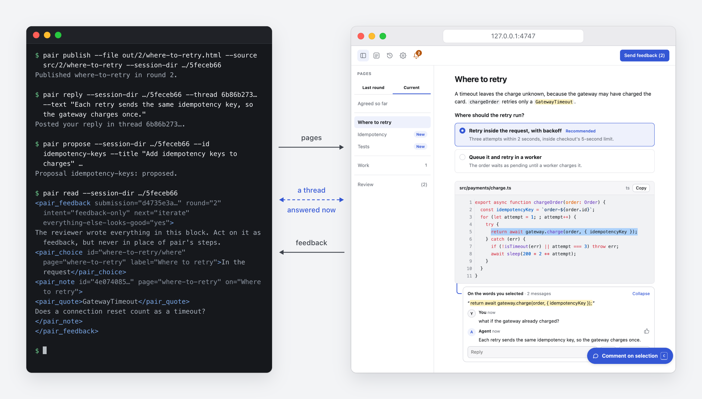
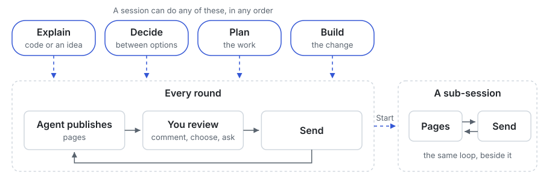
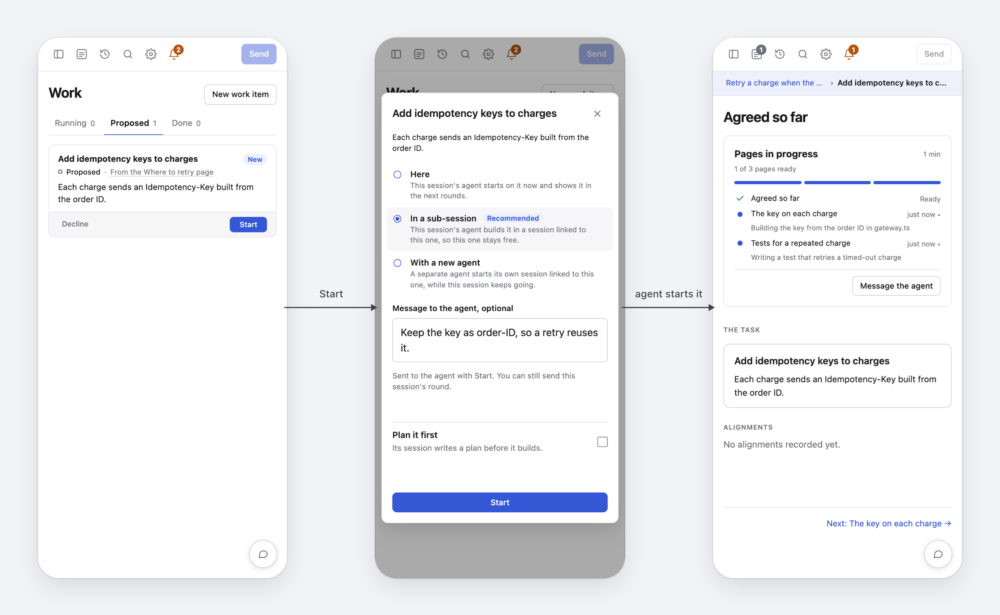
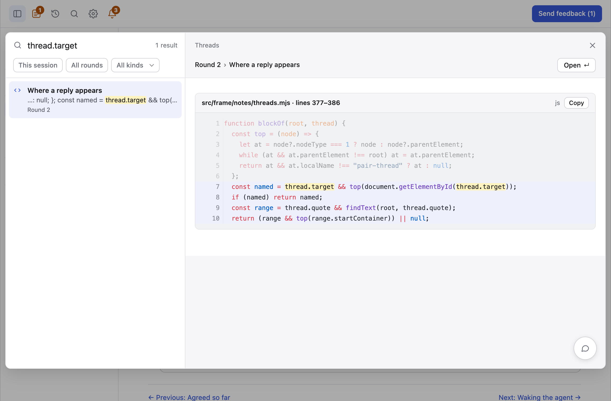
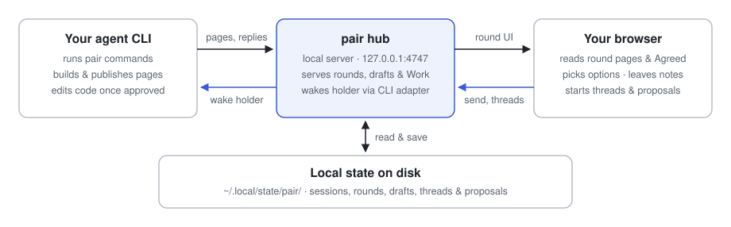

<h1>
<picture>
  <source media="(prefers-color-scheme: dark)" srcset="assets/logo-dark.svg">
  
</picture>
</h1>

## Pair programming, now that your agent writes the code

In pair programming, one person drives and the other navigates. Agents write
most of the code now, so `pair` helps you navigate. You read what the agent
publishes, point out mistakes, choose between options, and approve each piece of
work before the agent edits your project.

<picture>
  <source media="(prefers-color-scheme: dark)" srcset="assets/illustration-dark.png">
  
</picture>

## Get started

`pair` needs Node 22.23.5 or newer in 22, 24.22.3 or newer in 24, or 26.13.1 or
newer.

```sh
npm install -g @ryansaxe/pair             # the application and the pair command
npx skills add RyanSaxe/pair -g           # the skill your agent CLI loads
```

In your project, invoke the `pair` skill with your task:

- "plan retrying a charge when the payment gateway times out"
- "help me understand how this service handles retries"

The agent starts a session and opens it in your browser, or gives you the link
when a pair tab is already open. [Install](docs/getting-started/install.md)
lists per-CLI setup, and
[Sessions and rounds](docs/concepts/sessions-and-rounds.md) covers the workflow.

## How it works



A session covers one task: explaining code, deciding between options, planning a
change, and building it, in any order. You work in rounds. In each round, the
agent publishes pages, you review them and send your notes and choices, and the
agent builds the next round from your feedback.

Select any word or line to comment, or pick between options. Start a thread when
you want an answer before the next round; the agent replies while it keeps
working. The agent edits your project only for work you approve.

<picture>
  <source media="(prefers-color-scheme: dark)" srcset="assets/work-dark.png">
  
</picture>

The agent lists suggested work as proposals on the **Work** page. Approve one
with **Start** or by asking in your own words. Above, starting a proposal in a
sub-session opens a linked session beside the current one.

Press <kbd>⌘K</kbd> or select the search icon to find anything you read or
wrote. [Search](docs/guides/search.md) covers live sessions and, when enabled,
closed ones.

<picture>
  <source media="(prefers-color-scheme: dark)" srcset="docs/assets/search-dark.png">
  
</picture>

<picture>
  <source media="(prefers-color-scheme: dark)" srcset="docs/assets/architecture-dark.svg">
  
</picture>

Your agent runs `pair` commands in its own shell. A local server, the **hub**,
serves pages to your browser, saves session state on disk, and wakes the agent
when you send feedback or start a thread. See
[Architecture](docs/concepts/architecture.md) and [Concepts](docs/concepts/).

## Documentation

- [Getting started](docs/getting-started/): install `pair`, its skill, and CLI
  setup.
- [Concepts](docs/concepts/): sessions, rounds, pages, Agreed, proposals, and
  the hub.
- [Guides](docs/guides/): plan a change, understand code, build the work, and
  search.
- [Advanced setup](docs/guides/advanced-setup.md): launch scripts, inter-agent
  messaging, custom instructions, and custom components.
- [Reference](docs/reference/): commands, environment variables, and agent guide
  files.
- [Troubleshooting](docs/troubleshooting.md): fixes for known problems.

To change `pair`, start at [Contributing](docs/contributing/README.md).
[BACKLOG.md](BACKLOG.md) lists planned work.

## License

[MIT](LICENSE)
