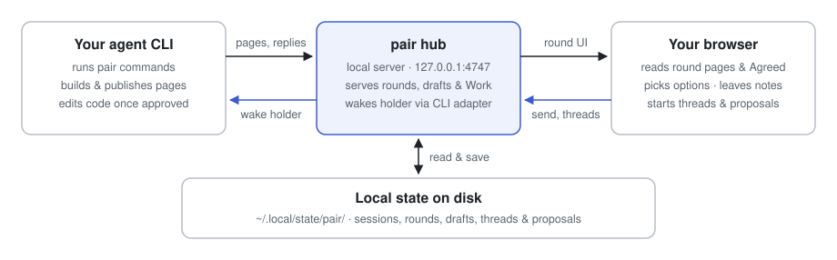

# Architecture

<picture>
  <source media="(prefers-color-scheme: dark)" srcset="../assets/architecture-dark.svg">
  
</picture>

Your agent runs `pair` commands in its own shell. Each session command sends a
request to the **hub**, one local process that serves every live session to your
browser and wakes the agent when you respond.

## The hub

### When the hub runs

- Any session command (such as `pair start`) starts the hub if none is running.
- A session is live from `pair start` until you close it or the agent pauses it.
  After `PAIR_HUB_IDLE_SECONDS` with no live sessions, the hub exits; the next
  `pair start` starts a fresh hub on the same port and reloads sessions from
  disk, keeping every session URL unchanged.
- The hub caches frame assets at startup and renders each round from those files
  plus `pages/<round>/`, so a new hub serves all rounds with its updated frame.
- Every hub response carries `X-Pair-Version`. When a session command sees a
  version mismatch, it replaces the hub (`pair start` before its request; other
  session commands after theirs).
- While a session is live, replacement happens only when the command runs from
  the hub's folder with no uncommitted changes under `src/` or `adapters/`
  (non-git installs such as npm count as clean). Otherwise the old hub stays up
  and the command explains why.
- Concurrent starts or replacements synchronize via `hub/start.lock`: the winner
  restarts the hub while others wait and connect to it.
- Before exiting, the old hub stops accepting connections and drains in-flight
  requests for up to 3 seconds; live sessions remain live on the new hub.

### The hub and your browser

- Every pair tab polls the session list and bell events every 5 seconds (plus
  open-session thread lines while Notifications is open).
- When the hub restarts on a new version, each tab reloads once at the same
  round, page, and scroll position, deferring while you type, use a dialog or
  menu, select text, or play a video. Down or older hubs without versions do not
  trigger reloads.
- The hub stores cleared bell lines, opened pages, and seen Work cards, syncing
  the bell, Sessions badge, and **New** labels across desktop and phone
  (`PAIR_HUB_HOST`) within one poll. Layout preferences (sidebar and page width)
  stay local to each browser.
- The hub stores completed draft items with monotonic revision numbers. Tabs
  push completions and pull newer revisions on poll. On conflict across devices,
  the last write to reach the hub wins and deletions persist; unsubmitted typing
  stays in the local browser.
- Draft sync updates choices, answers, drawings, and note marks inline, and
  redraws the full page only when you are not typing, using a modal or
  prototype, or mid-video (an open drawer does not block redraws).
- The hub tracks when a local tab last polled. When the agent publishes a new
  session's first Agreed, `pair publish` tells it to open the URL if no tab
  polled in the last 90 seconds, or to share the link in chat otherwise.
- The root URL (`http://127.0.0.1:4747/` by default) redirects to the session
  with the oldest waiting round, or else the session you opened last (falling
  back to another open session if closed), so you can bookmark it.

## When the hub wakes the agent

Unless the session is paused, the hub wakes the holder when:

- You send a round.
- You post in a [thread](threads.md). The wake includes your text (truncated at
  a space to 500 characters), attached image count, and the `pair read --thread`
  command for the full thread and image paths.
- You start a [proposal](proposals-and-work.md) here or in a sub-session
  (including your Start message).
- Another agent starts a proposal from your words with `pair propose --start`.
  (When the holder runs it itself, `pair propose` prints the started work
  directly, with no wake or duplicate `pair read` entry.)
- You press **Open a new agent session**, or **Start agent** with a message
  (which starts a thread on the card).
- A started page or proposal has gone quiet for 10 minutes with no `pair`
  command for 10 minutes (see [Quiet work](#quiet-work)).

Declining a proposal, giving a thumbs up, or closing a linked session sends no
wake; the holder sees declines and closed linked sessions on its next
`pair read`.

### Quiet work

A started page is quiet when its last note (or its start) is over 10 minutes
old. A proposal running here is quiet when it is unfinished, has no parts or
remaining parts, and has had no part updates for over 10 minutes. (This catches
silent stalls while a subagent works.)

- While work is quiet, every session command's next step appends its ID, idle
  minutes, and the `pair progress` or `pair propose` command to update it.
- Once per minute, if work is quiet and no `pair` command (including a
  subagent's) ran on the session in 10 minutes, the hub wakes the holder listing
  all quiet work.
- The hub does not re-wake for the same item until it receives a new page note
  or part update, or another item goes quiet. Last-command timestamps live in
  memory and reset on hub restart.

Because only started pages count, `pair publish` refuses to leave unpublished
pages with none started unless `--start` names the next page. A proposal with
all parts done or dropped is not quiet; the next step still prompts the agent to
mark it done.

## How the hub wakes each agent CLI

`pair start` records the wake target for its CLI, or refuses with setup
instructions if unwakeable.

| Agent CLI       | Recorded by `pair start`                                                                                         | Delivery mechanism                                                                                                                  |
| --------------- | ---------------------------------------------------------------------------------------------------------------- | ----------------------------------------------------------------------------------------------------------------------------------- |
| Claude Code     | `CLAUDE_CODE_MESSAGING_SOCKET`, `CLAUDE_CODE_MESSAGING_TOKEN`                                                    | Sends a message over the inbox socket.                                                                                              |
| Codex           | `CODEX_THREAD_ID`, app-server daemon socket                                                                      | Sends `turn/steer` into an active turn, queues + starts a turn on an idle daemon thread, or runs `codex queue --thread ID --message TEXT`. |
| Copilot CLI     | `COPILOT_AGENT_SESSION_ID`, Copilot port                                                                         | Sends via Copilot CLI's SDK with mode `immediate`, falling back to `enqueue`.                                                       |
| pi              | `PAIR_PI_SOCKET`, `PAIR_PI_SESSION` (from extension)                                                             | Sends a JSON line over the extension's socket; extension delivers a steering message.                                               |
| opencode        | `PAIR_OPENCODE_SOCKET`, `PAIR_OPENCODE_SESSION` (from plugin)                                                    | Sends a JSON line over the plugin's socket; plugin calls `promptAsync`.                                                             |
| Antigravity CLI | `ANTIGRAVITY_CONVERSATION_ID`, `ANTIGRAVITY_LS_ADDRESS`, `ANTIGRAVITY_CSRF_TOKEN`, `ANTIGRAVITY_AGENTAPI_EXE`   | Runs `agy agentapi send-message` with the conversation ID and line against agy's language server.                                   |

Most CLIs read wakes mid-turn; non-daemon Codex and Copilot `enqueue` read them
at turn end. See
[Adapters](../contributing/adapters.md#when-the-cli-reads-the-line).

### Codex

Plain `codex` (0.160+) runs threads on a shared app-server daemon at
`$CODEX_HOME/app-server-control/app-server-control.sock` (default `~/.codex`).

- Active turn on daemon: sends `turn/steer` over the socket (read between
  steps).
- Idle thread on daemon: calls `thread/queue/add` then `thread/queue/start` (so
  a turn starts even after an interrupted turn).
- Otherwise (including Codex < 0.160): runs `codex queue`, which starts a turn
  immediately if idle or delivers at turn end if busy.

`pair start` refuses under Codex until `~/.codex/rules/pair.rules` exists
(`pair setup-codex` writes it) so Codex's sandbox does not prompt on every
command.

### Copilot CLI

Copilot CLI requires `--ui-server`. Without it, `pair start` refuses and prints
`copilot --ui-server --resume <session id>`.

### pi and opencode

Both require registering pair's extension/plugin once; otherwise `pair start`
prints the `pi install` command or opencode plugin path and config file. The hub
marks `wake.last.ok` true once the listener acknowledges receipt (before the
agent reads it). Exited CLIs fail with `the agent CLI has exited (ENOENT …)` on
clean exit or `(ECONNREFUSED …)` if killed.

### Antigravity CLI

`agy` injects its language server address, CSRF token, conversation ID, and
executable path into child commands. `pair start` saves all four, and the hub
runs `agy agentapi send-message`, delivering after the current tool call or
starting a new turn when idle (agy shows the agent's reply, not the wake line).

Because the address and token rotate on restart while the conversation ID stays
constant across `--conversation` / `--continue`, wakes fail with agy's error
(such as `connect: connection refused`) until the resumed agent runs a `pair`
command. To keep subagents out of `pair agents`, `pair` checks
`agy agentapi get-conversation-metadata` and routes subagents through their root
conversation.

These `agentapi` commands and env vars are undocumented for CLI use (verified on
Antigravity CLI 1.5.6 and 1.5.13). If a future release drops any env var,
`pair start` names the missing variable; if it drops `agentapi`, wakes fail with
agy's error and subagent detection stops working.

## The result of a wake

`pair status` reports the holder and last wake result:

- `via` names the delivery path (such as `steer`, `queue`, or `parent` for a
  Codex subagent).
- `holder.steerable` in `status.json` is `true` when the CLI reads messages
  mid-turn.
- On wake failure, the progress card displays "Could not wake the agent. Send a
  message in chat." with the [handoff line](holders-and-handoff.md), and the
  session list shows "Can't wake" until the holder runs a `pair` command.
- Pending wakes interrupted by a hub stop are sent by the next hub that loads
  the session.

## Storage

pair stores all state under `$XDG_STATE_HOME/pair/` (default
`~/.local/state/pair/`):

```text
hub/
  hub.json           pid, port, hosts, code version, registration secret
  hub.log
  start.lock         pid of the command starting or replacing the hub
  seen.json          cleared bell lines, opened pages, seen Work cards
sessions/<dir>/      directory name is not the session ID
  status.json        title, holder, pause, close time, last wake, open round, linked parent
  connection.json    session ID, hub origin, agent token, agent CLI name
  wake.json          holder wake target (socket, thread ID, etc.)
  pages/<round>/     published page records
  src/<round>/<id>/  page source files
  rounds/            legacy built rounds (fallback when pages/ has no records)
  draft.json         completed notes, choices, and answers until sent
  feedback/          your submissions
  uploads/           comment images (PNG, JPEG, GIF, WebP up to 10 MB)
  scenes/            editable drawing answers and diagram sketches
  threads/           one file per thread
  proposals/         one file per proposal
  activity.json      last 50 events since last reopen (bell and Notifications)
  output/            command output exceeding 10,000 bytes
```

Trial git worktrees also live inside the session directory. Closing a session
deletes nothing, and the agent asks before deleting worktrees.

Legacy `interactive-plan` sessions remain under
`~/.local/state/interactive-plan/`; `pair` does not open them.
