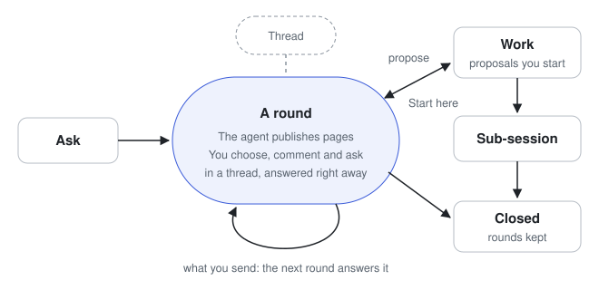
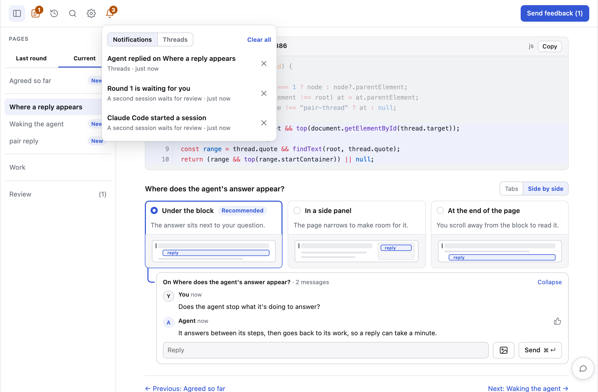
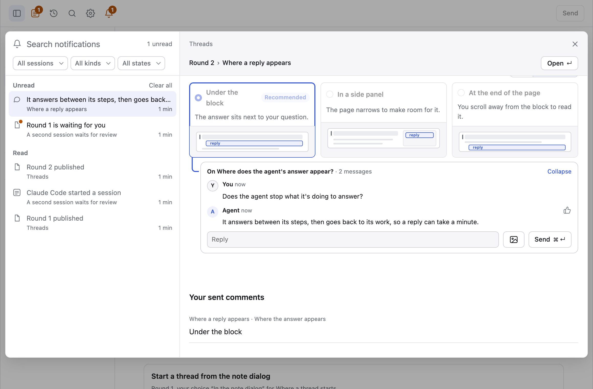

# Sessions and rounds

A **session** is one task with your agent (exploring code, planning, or building
in any order). Each session has its own URL, shows every round in one tab, and
lasts until you close it.

<picture>
  <source media="(prefers-color-scheme: dark)" srcset="../assets/session-dark.svg">
  
</picture>

## A round

A **round** is a batch of pages published together that you answer in one
submission:

1. The agent publishes **Agreed** and the page list first, then each remaining
   page as it finishes. You can start reading immediately.
2. You pick options, answer questions, and add comments.
3. You click **Send**, pick what comes next, and submit. The agent reads your
   submission and publishes the next round.

A progress card at the top of Agreed tracks pages as they arrive; once all pages
are published, the round waits for you. Only **Send** ends a round; starting a
proposal or thread leaves the round open.

## The sidebar

The sidebar lists the round's pages, **Work**, and **Review**. The first header
button toggles it. Above 720px, it starts open and remembers your choice per
browser; at 720px and below, it starts closed, overlays the page when opened,
and closes when you pick a page.

**Current** lists this round's pages; **Last round** lists the previous round
without switching your open page. Pick an older round from the header's Rounds
(clock) button to inspect it in the **Last round** tab (relabeled **Round N**).

## The page's width

Above 1160px, drag handles appear at the vertical center of the page's outer
edges and the sidebar edge. Drag a page handle to resize from 1160px up to full
window width (staying centered); drag the sidebar handle between 224px and
400px. Double-click a handle to reset. Widths save per browser across all
sessions on the hub and apply to other tabs on next load.

Text, Agreed, Work, Review, threads, code, diffs, and prototypes all scale with
page width while keeping the center block anchored. Diffs switch to
**Side by side** at 900px or wider unless manually toggled; full-width images
cap at 1200px. Smaller windows shrink smoothly and restore your saved width when
widened. At 1160px and below, handles hide and the sidebar locks to 224px.

## What you can do on a page

| Goal                      | Action                                                                                                               |
| ------------------------- | -------------------------------------------------------------------------------------------------------------------- |
| Choose between options    | Click an option. **Recommended** options count only once you click them.                                             |
| Answer a question         | Type in the box and click **Answer**, or draw when prompted.                                                         |
| Comment on words          | Select text and click **Comment on selection** at bottom right.                                                      |
| Comment on a block        | Click the block, then click the bottom-right comment button or press <kbd>c</kbd> (<kbd>j</kbd>/<kbd>k</kbd> moves). |
| Comment on the page       | With nothing selected, click the comment button or press <kbd>c</kbd>.                                               |
| Comment on a diagram box  | Click the diagram to open it full size, then click a box.                                                            |
| Sketch on a diagram       | Open the diagram full size, click **Sketch on this diagram**, and save to attach it to a comment.                    |
| Get an answer now         | Send the comment as a [thread](threads.md).                                                                          |
| Approve or decline work   | Use a proposal's buttons on the page or on [Work](proposals-and-work.md).                                            |
| Review what you will send | Press <kbd>r</kbd>.                                                                                                  |
| See all shortcuts         | Press <kbd>?</kbd>.                                                                                                  |

On desktop, comments, **Send**, **Start**, **New work item**, and shortcuts open
in a drawer anchored beside what you clicked without blocking the page behind
it. Only one drawer opens at a time; opening another saves any typed comment to
your draft first. × and <kbd>Esc</kbd> close the drawer and preserve comment
text. On phones and tablets, drawers open as modals.

## Your draft

pair saves draft progress continuously. Completed items sync via the hub across
devices (for example, phone to desktop):

- notes saved with **Add to draft** (including edits and removals)
- decision choices and checkboxes
- saved answers (**Answer**) and saved drawings (**Save drawing**)
- the **Everything else looks good** switch

In-progress text (open comment, unsaved answer/drawing, unsent thread reply, and
Send message) stays in the browser you typed it in. Your browser also caches
completed items offline and syncs when the hub reconnects; while offline, a
banner shows "The hub is unreachable. Your draft is saved in this browser." and
**Send** is disabled.

**Send** opens a drawer to pick the agent's next step:

Standard rounds:

- **Keep iterating**: continue with the next pages based on your comments.
- **Write a plan**: make the next round a self-contained plan.
- **Build it**: apply your comments and build what Agreed describes here.

Plan rounds:

- **Update the plan**: revise the plan with your comments.
- **Back to iterating**: set the plan aside and keep exploring.
- **Build it**: apply your comments and build the plan here.

The first choice is selected by default (never Build it); the submit button
reads **Build it** only when Build it is selected. The agent can also produce a
plan round on its own when ready.

Typed answers send only after you click **Answer**; the Send drawer lists any
unsaved answers with links. **Everything else looks good** (on by default)
signals agreement with unchallenged statements on the pages without selecting
options or answering questions for you. After sending, **What you sent** records
your choices and message.

Only one submission is accepted per round. If another tab or device already sent
the round, the hub refuses the second send and keeps your draft for the next
round. If that refused send included a message, **Send as a message** sends it
immediately as a thread (like **Message the agent**) and clears only the message
from your draft.

## Agreed

Agreed (listed as **Agreed so far**) is the first page of every round. It states
the **task** and lists settled decisions under **Alignments**, each linked to
where it was settled. Comment on anything wrong. Plan rounds show a grey
**Plan** tag on Agreed and in the Rounds panel.

| Tag               | Meaning                                                                    |
| ----------------- | -------------------------------------------------------------------------- |
| New, Updated      | Added or revised this round.                                               |
| Revisiting        | Reopened by the agent after your send.                                     |
| No longer applies | Retired with a reason (collapsed in a fold at the bottom).                 |

## When the agent edits your project

The agent edits your project only for approved work: sending **Build it**,
starting a [proposal](proposals-and-work.md), or requesting work in your own
words (which the agent records and starts as a proposal). Before approval, trial
experiments run only in a git worktree (or plain folder for non-git projects)
inside the session directory, leaving your checkout untouched. The agent asks
before deleting worktrees.

## Sessions and notifications

### The session list

Open the session list via the Sessions header button or <kbd>g</kbd>. Live
sessions appear in start order, with
[sub-sessions](proposals-and-work.md#sub-sessions-and-new-agent-sessions)
indented under their parent with ↳. Each row has **Copy handoff line** and ✕ to
close.

- The Sessions badge counts other sessions with a waiting round, an unwakeable
  agent (orange), or unopened pages in an unsent round (blue), falling back to a
  grey count of other live sessions. Opening a session, clearing its bell row,
  or reopening clears the waiting count (the row still says **Waiting**). The
  current tab's session is never counted.
- Rows show **N new** for unopened pages in unsent rounds; individual unopened
  pages are labeled **New**.
- Press <kbd>1</kbd>–<kbd>9</kbd> for numbered sessions (sub-sessions have no
  number) or <kbd>w</kbd> for the next waiting session (including sub-sessions).
- Sessions appear immediately on start, showing title, agent, and progress card
  until the first Agreed publishes.

### The bell

The bell (<kbd>n</kbd>) lists items needing attention across all live sessions:
waiting rounds, new thread replies, and pending proposals. Its orange badge (and
tab title) shows the row count, grouping multiple new replies in one thread into
one row with the opening question and session name. The dropdown shows the 5
newest rows with a link to the rest.

Click a row to jump to its thread, Work card, or Agreed page (switching sessions
if needed) and mark it read. **Clear all** and desktop hover ✕ also mark rows
read; all rows remain in [Notifications](#notifications).

<picture>
  <source media="(prefers-color-scheme: dark)" srcset="../assets/bell-dark.png">
  
</picture>

### Notifications

Click **All notifications** (or **See N more**) at the bottom of the bell to
open a split modal with all live-session threads, rounds, proposals, and session
starts on the left (in three newest-first groups) and the live page on the
right:

| Group                    | Marker              | Enters when                           | Leaves when                                                                   |
| ------------------------ | ------------------- | ------------------------------------- | ----------------------------------------------------------------------------- |
| **Unread**               | Orange dot          | Reply, round, or proposal arrives     | Opened, answered, thumbed up, decided, or cleared on any device               |
| **Waiting on the agent** | Hollow dot          | You post in a thread                  | Agent replies (moves to **Unread**)                                           |
| **Read**                 | None (grey text)    | Everything else or cleared rows       | New reply arrives                                                             |

The bell badge and window header both count **Unread** rows.

Clicking a row or keeping its loaded preview open for 3 seconds in the active
tab marks it read (quick arrow-key scans or search typing do not; viewing a
reply or card on its own page leaves it unread). Newly read rows lose their dot
but stay put until you reopen or change filters.

Waiting rounds stay unread until you engage with them (open via session list,
<kbd>w</kbd>, or number key; open a page manually; or start a note). Merely
having the tab open does not clear them, and a tab hides its own session's
waiting round. You can reply directly in the right-hand preview or click
**Open** to navigate there.

<picture>
  <source media="(prefers-color-scheme: dark)" srcset="../assets/notifications-dark.png">
  
</picture>

| Key                                                            | Action                      |
| -------------------------------------------------------------- | --------------------------- |
| <kbd>↑</kbd> <kbd>↓</kbd>, <kbd>Ctrl+J</kbd> <kbd>Ctrl+K</kbd> | Move through rows           |
| <kbd>Enter</kbd>                                               | Open the selected row's page |
| <kbd>Esc</kbd>                                                 | Close the window            |

Type in the filter box to search all live-session threads and proposals (even
read or cleared ones); if nothing matches, a button opens full
[search](../guides/search.md) with your query.

### System notifications

When enabled in Settings, your browser sends OS notifications for new bell rows,
session starts, and wake failures outside your active tab, skipping rows already
cleared or started on any device.

## Closing a session

Click ✕ in the session list and confirm when you are finished (after telling the
agent any final steps). The session becomes read-only with all rounds preserved;
the hub sends no wake and refuses future non-`pair status` commands with a
closed notice.

Closing deletes no files or worktrees. Closing a sub-session marks its parent
proposal done. A closed parent with open sub-sessions stays as a grey heading
until all its sub-sessions close.

To reopen, click **Reopen** under the header and paste the copied command into
any agent. Running it makes that agent the holder, reloads open tabs live,
publishes any incomplete round pages, and clears the done mark on a
sub-session's parent proposal.

Everything predating a reopen counts as seen across devices (cleared from bell,
no **New** marks, threads marked **Read**); an unsent waiting round still shows
**Waiting** in the session list. New activity after reopen notifies normally.
