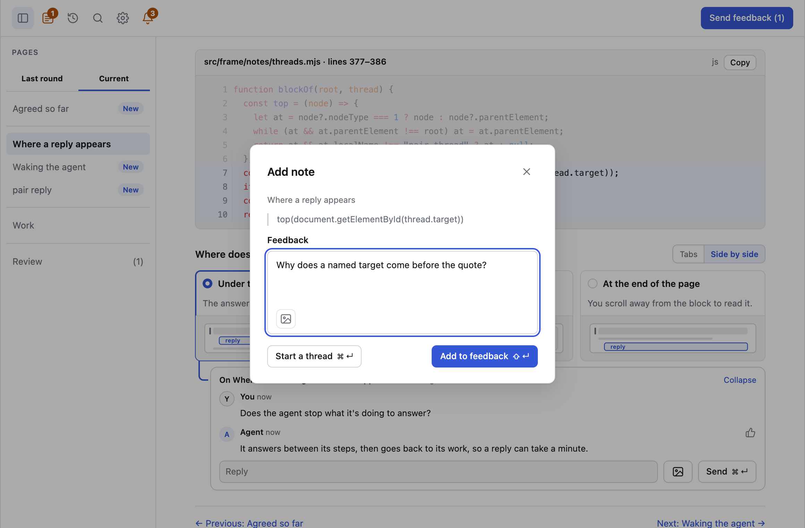

# Threads

Start a **thread** when you want an answer right away, before the next round.

## Starting a thread

Write a comment and press **Start a thread** instead of **Add to draft**
(<kbd>⌘</kbd> <kbd>Enter</kbd> on macOS, <kbd>Ctrl</kbd> <kbd>Enter</kbd>
elsewhere). The hub sends the comment to the agent immediately, and pair shows
the reply under the block you commented on, or under the line in a diff.

Pressing **Comment** on a [proposal](proposals-and-work.md) starts a thread
under that proposal's card.

<picture>
  <source media="(prefers-color-scheme: dark)" srcset="../assets/note-dialog-dark.png">
  
</picture>

## The thread's card

The card's header names what the thread targets: the block name for a block
comment, or the table row, code line, option, or checklist item with the quoted
selection for selected words.

When a block has four or more threads, pair collapses all but the two newest.
Manual expand or collapse choices stay as you set them.

## Replies

- The agent can reply with text, code, diffs, diagrams, charts, formulas, or a
  prototype from this round. Longer answers and new decisions go on a page in
  the next round.
- Starting a thread does not change the current round's pages. Decisions settled
  in a thread appear on Agreed in the next round with a link to the thread.
- If you ask to change work in progress, the agent applies the change. If you
  ask for other work, the agent records and starts a proposal quoting you (see
  [When you ask in your own words](proposals-and-work.md#when-you-ask-in-your-own-words)).
- If your message needs no reply, the agent runs `pair reply --ack`. The card
  shows "Acknowledged by the agent" with a timestamp, and the bell lists it like
  a reply. Your next message in the thread expects a reply again.
- Press the thumbs up beside the agent's name to accept its suggestion without
  typing. The hub sends no wake; the agent sees it on its next `pair read` or
  thread read and does not reply. pair clears the reply from the bell. Press
  thumbs up again to undo.

## When the agent reads a thread

Timing depends on the agent CLI:

| Agent CLI                                               | When the agent reads the thread                                       |
| ------------------------------------------------------- | --------------------------------------------------------------------- |
| Claude Code, pi, opencode, Antigravity CLI              | Between turn steps, after the current tool call                       |
| Codex on its app-server daemon (plain `codex` ≥ 0.160)  | Between turn steps                                                    |
| Copilot CLI                                             | Immediately (moves a running shell command to the background)         |
| Any other Codex                                         | When its turn ends (for a round, after publishing the last page)      |
| Codex subagent spawned by another Codex thread          | After its parent forwards the message                                 |

A reply can wait a minute during a long step. The tooltip on ⓘ beside "Sent to
the agent", and on **Message the agent** in the progress card, shows which rule
applies.

## Thread status

The line under your message reports delivery status:

| Line                                  | Meaning                                                                                                                                            |
| ------------------------------------- | -------------------------------------------------------------------------------------------------------------------------------------------------- |
| Agent paused. Send a message in chat. | The session is paused, so the hub sent no wake. Ask the agent in chat to continue; its `pair start` prints the thread ID.                          |
| Sent to the agent                     | The hub woke the agent, or `pair start` (after a pause) / `pair start --reopen` (after Close) printed the thread ID.                               |
| Read · replying                       | The agent read the thread and is writing a reply.                                                                                                  |
| Acknowledged by the agent             | The agent acknowledged your message with `pair reply --ack`.                                                                                       |
| Could not reach the agent             | The wake failed. The card shows the handoff line so another agent can [take the session over](holders-and-handoff.md).                             |
