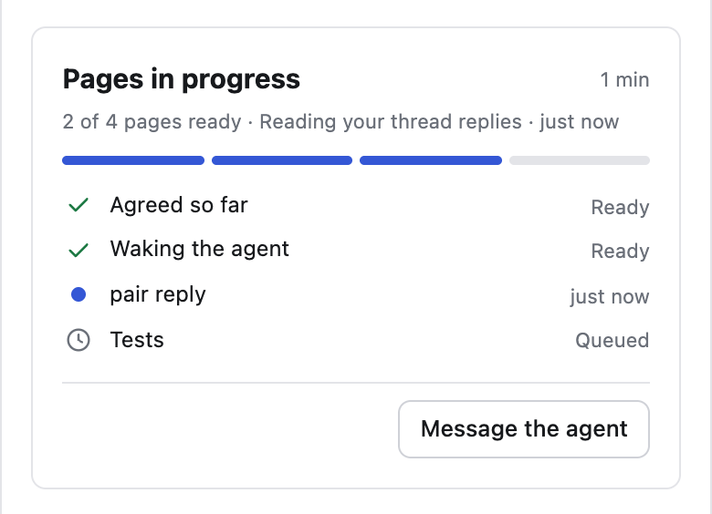

# Build the work

The agent starts building when you send a round with **Build it** or start a
[proposal](../concepts/proposals-and-work.md).

- **Build it** builds what Agreed describes in this session's rounds, following
  the latest plan if one exists.
- A proposal started **Here** runs in this session. One started in a sub-session
  or with a new agent runs in its own linked session, opened from the card. If
  you checked **Plan it first**, that session plans first and builds nothing
  until you choose **Build it** there.

## Follow the build

<picture>
  <source media="(prefers-color-scheme: dark)" srcset="../assets/progress-card-dark.png">
  
</picture>

- The agent works on a new branch and names it on the first build page.
- Agreed shows the task and a progress card listing each page as Ready, Queued,
  or in progress with its last update time and note.
- The agent publishes each part as soon as it is reviewable so you can redirect
  it while it builds the rest.
- For details the plan left open, the agent decides, keeps building, and
  explains the choice on the next page.
- Inline fixes appear on the work's pages; unrelated work becomes a new
  proposal.

## Steer it

| Goal                            | Action                                                                   |
| ------------------------------- | ------------------------------------------------------------------------ |
| Change work in progress         | Ask in a thread or comment. The agent applies the change.                |
| Approve work found along the way | Start the proposal the agent recorded for it.                            |
| Stop                            | Tell the agent in chat. It pauses the session until you ask to continue. |

## Review the work

On the final page, the agent explains the change so you can review and maintain
it. For a proposal running here, the agent marks it done after publishing that
page and pair moves the card to Done. Sending a round requesting changes reopens
the proposal, moves it back to Running, and publishes updates next round.

Work in a sub-session or new agent session finishes when you close that session.
Ask the agent for any final steps, such as opening a pull request, before
closing.
