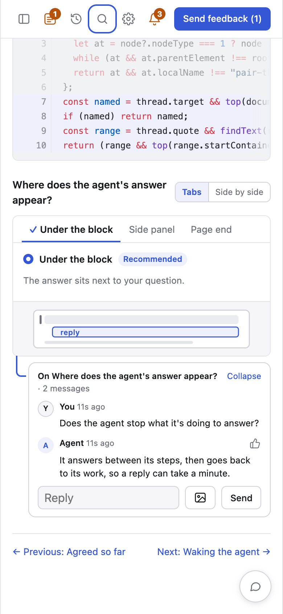

# Plan a change

Start a planning session when you do not yet know how to build a change. The
session ends in a plan round detailed enough for anyone to build from without
seeing earlier rounds.

## Ask

```text
/pair plan retrying a charge when the payment gateway times out
```

Share what the code cannot tell the agent: why you need the change and any
constraints you already have.

## Each round

<picture>
  <source media="(prefers-color-scheme: dark)" srcset="../assets/plan-phone-dark.png">
  
</picture>

- **Read the task first** at the top of Agreed. Every page follows it, so
  correct it right away if it drifts.
- **Pick every option you care about.** An option marked **Recommended** counts
  only after you click it.
- **Ask to see it.** If a page describes a layout, flow, or interface only in
  prose, comment to ask for a mock or code.
- **Use threads for quick questions** so you get answers before sending the
  round.

## Ask for a plan

Choose **Write a plan** in the Send drawer. The agent resolves open decisions
with its recommended options, records them on Agreed, and publishes a plan
round. The agent can also write a plan on its own when it has enough context.

Plan rounds show a grey **Plan** tag beside the Agreed title and in the Rounds
panel.

## Before you build

Verify that the plan:

- shows every mock, wording, and interface exactly as you approved it;
- states how to verify the finished work;
- matches every alignment on Agreed.

If something is wrong, comment and send with **Update the plan**, or choose
**Back to iterating** to explore again.

When the plan is ready, send with **Build it**. The agent applies your final
comments and builds the work in this session (see
[Build the work](build-the-work.md)). To build in another session instead, ask
the agent to record a proposal and start it from Work in a sub-session or with a
new agent.
