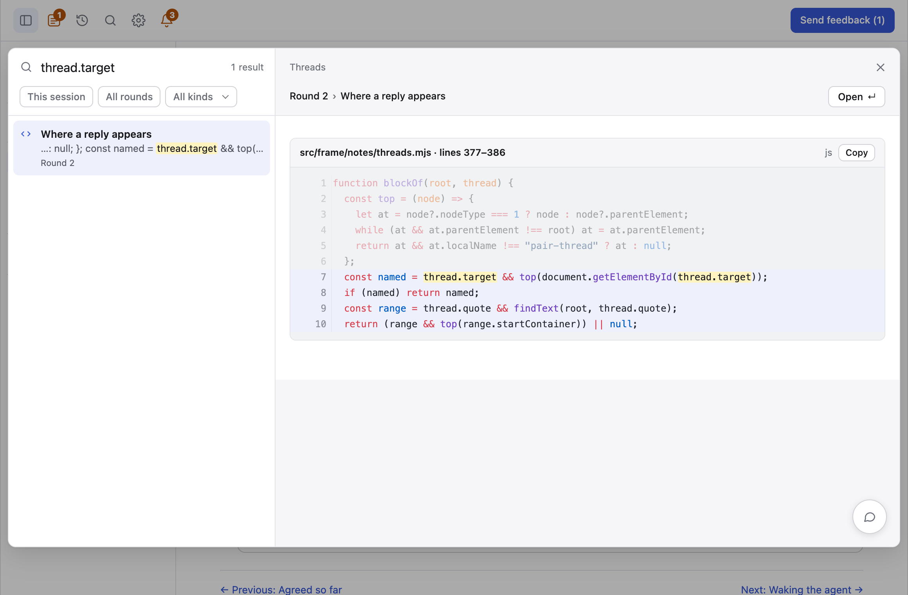

# Search

Search finds anything you read or wrote in pair across pages, threads, notes,
answers, proposals, and Agreed, in live sessions and optionally closed ones.

<picture>
  <source media="(prefers-color-scheme: dark)" srcset="../assets/search-dark.png">
  
</picture>

## Open it

Click the magnifying glass in the header, or press <kbd>⌘K</kbd> on macOS,
<kbd>Ctrl+K</kbd> elsewhere, or <kbd>/</kbd>. Results filter on every keystroke,
matching typos and partial words. To search only bell activity, use the search
field in [Notifications](../concepts/sessions-and-rounds.md#notifications).

| Key                                                            | Action                                       |
| -------------------------------------------------------------- | -------------------------------------------- |
| <kbd>↑</kbd> <kbd>↓</kbd>, <kbd>Ctrl+J</kbd> <kbd>Ctrl+K</kbd> | Move through results and preview each one    |
| <kbd>Enter</kbd>                                               | Open the selected result                     |
| <kbd>Option+S</kbd>                                            | Toggle this session vs. all sessions         |
| <kbd>Option+R</kbd>                                            | Toggle all rounds vs. the latest round       |
| <kbd>Tab</kbd>                                                 | Move through the filters and Open            |
| <kbd>Esc</kbd>                                                 | Close search and keep your query for next time |

Search keeps your query and filters as you switch sessions in a tab.

## Narrow it

Three filter menus sit above the results, defaulting to this session, all
rounds, and all kinds. Changed menus appear tinted, and each supports multiple
selections (showing a count when more than one is chosen):

- **Sessions**: all live sessions, this session, and every other live session,
  newest first. **Include closed sessions** at the bottom adds closed sessions
  and changes the label to **All + closed**.
- **Rounds**: all rounds and each session's latest round. When a single session
  is selected, its individual round numbers also appear; selecting multiple
  sessions clears specific round numbers.
- **Kinds**: the six content kinds with match counts.

When nothing matches, a button offers to loosen one filter at a time while
keeping your query, ending with closed sessions. Closed-session results show
**Closed** on their row.

## The preview

The preview renders the real page in the session's frame, scrolled to and
highlighting your match. Matches inside closed options or folds open the section
with the most hits. A matched note or answer pins a card with your text above
its target block.

Comments, threads, replies, choices, answers, and proposals all work inside the
preview and target the result's own session and round. Older rounds and closed
sessions keep their read-only rules.

Clicking a result or stepping with arrow keys updates the preview. On a phone,
only results appear while the on-screen keyboard is open; dismissing the
keyboard (Search key, scrolling, or tapping a result) shows the preview below.
Hardware keyboards keep the preview visible while typing. Typing in a note or
reply on a phone expands the preview full-screen until you leave the text box.

## Open a result

Pressing <kbd>Enter</kbd>, clicking **Open**, or clicking the previewed result
closes search and navigates there with matches highlighted until you change
pages. Live sessions open editable; closed sessions open read-only. Browser Back
and Forward track opened results, not preview steps.

## What it leaves out

- Text inside images.
- Unchanged lines hidden behind a diff's folds (changed lines and context are
  indexed).
- Text coming only from a script larger than 32 KB, such as a bundled library in
  a prototype.

Custom components work with search automatically (see
[Writing a component](../../src/components/README.md)).

## Agents

Agents run `pair search` to look up what earlier sessions settled instead of
asking you again. See [Commands](../reference/commands.md).
