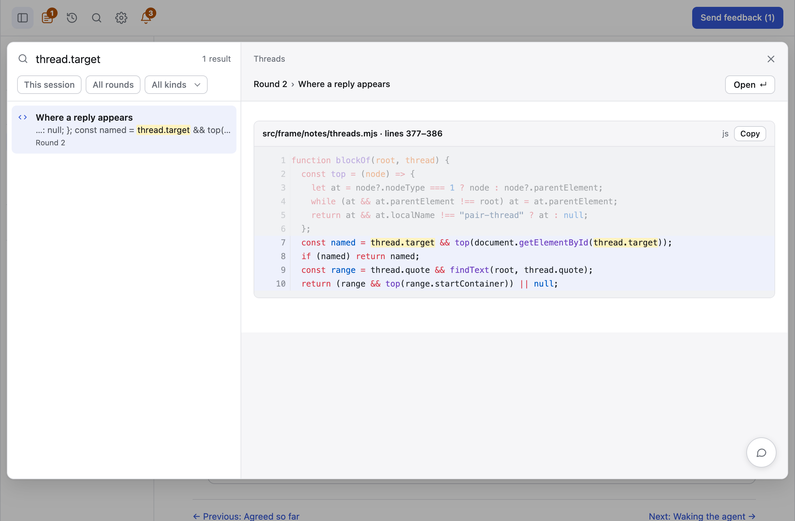

# Search

Search finds anything you read or wrote in pair, without you remembering its
session or round. It covers pages, threads, notes, answers, proposals and
Agreed, in live sessions, and in closed ones when you ask.

<picture>
  <source media="(prefers-color-scheme: dark)" srcset="../assets/search-dark.png">
  
</picture>

## Open it

Select the magnifying glass in the header, or press <kbd>⌘K</kbd> on macOS,
<kbd>Ctrl+K</kbd> elsewhere, or <kbd>/</kbd>. Type a few words, and the list
filters on every keystroke. Typos and partial words still match.

| Key                                                            | What it does                                         |
| -------------------------------------------------------------- | ---------------------------------------------------- |
| <kbd>↑</kbd> <kbd>↓</kbd>, <kbd>Ctrl+J</kbd> <kbd>Ctrl+K</kbd> | Moves through the results and shows each one         |
| <kbd>Enter</kbd>                                               | Opens the selected result                            |
| <kbd>Option+S</kbd>                                            | Switches between this session and all sessions       |
| <kbd>Option+R</kbd>                                            | Switches between all rounds and the latest round     |
| <kbd>Tab</kbd>                                                 | Moves through the filters and Open                   |
| <kbd>Esc</kbd>                                                 | Closes search and keeps your words for the next time |

Search keeps your words and filters as you move between sessions in a tab.

## Narrow it

Three menus sit above the results. A search starts on this session, all rounds
and all kinds, and a menu you've changed is tinted. In each one you can choose
several things, and its label shows a name, or a count once there are several.

- **Sessions** offers all sessions, this session and every other live session,
  newest first. All sessions means live ones. Include closed sessions, at the
  bottom of the menu, adds closed ones to the search and to this list, and the
  button then reads All + closed.
- **Rounds** offers all rounds and the latest round, which is each session's
  newest round. When one session is chosen, it also lists that session's rounds,
  because a round number means something different in each session. Widening to
  more than one session clears the round numbers you chose.
- **Kinds** offers the six kinds, with how many results each has.

When a search finds nothing, a button offers to loosen one filter and keeps your
words. The last filter it offers is closed sessions. A result in a closed session
says Closed on its row.

## The preview

The preview is the result's real page, from the session's own frame, showing
only the block with your words and its threads. A diff is the real diff, a
proposal is its real card, and a decision shows what you chose. When your words
are in an option or a fold that's closed, the preview opens the part that shows
the most of them. A note or answer you sent shows its block under a card with
your words, because your words aren't in the block.

Everything the page allows works in the preview: comments, threads, replies,
choices, answers and proposals. Each goes to the result's own session and round,
and a comment names them. An older round or a closed session allows what its page
allows.

A click on a result shows it, and the arrow keys show each result as you move.
On a phone, the best result shows under the results as you type, and a tap shows
another. With nothing typed, the newest results wait for a tap.

## Open a result

Enter, Open or a click on the result that's showing closes search and goes to
the result, scrolled to your words, which stay highlighted until you move to
another page. A result in another live session opens that session, so you can
still reply, and a result in a closed session opens read-only. The browser's
Back and Forward return through each page and session, and moving through
results adds nothing to them.

## What it leaves out

- Text inside images.
- The unchanged parts of a whole file behind a diff's folds. A diff's changed
  lines and their context are searchable.
- Words that come only from a script over 32 KB, such as a bundled library in a
  prototype.

A round keeps the frame it was published with, so a round published before
search has no search icon when you open its address directly. The preview shows
it on today's frame.

A custom component works with search without any code. See
[Writing a component](../../src/components/README.md).

## Agents

An agent runs `pair search` to find what an earlier session said, instead of
asking you again. See [Commands](../reference/commands.md).
